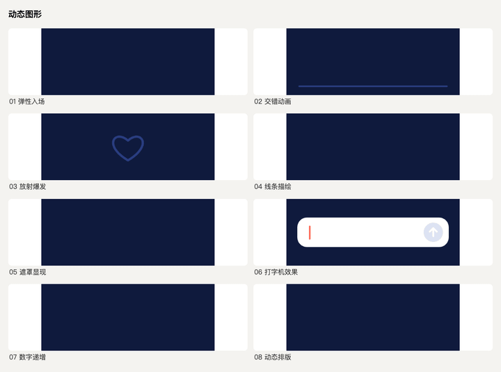
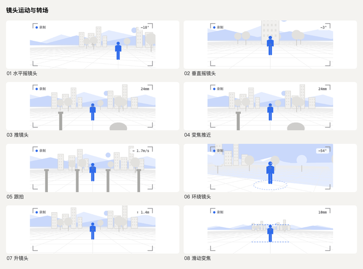

# Motion Prompt 简体中文汉化版

[English](README.en.md) | **简体中文**

本仓库是 [Shohei Ohtaki（showheyohtaki）](https://github.com/showheyohtaki) 创建的 [Motion Prompt](https://github.com/showheyohtaki/motion-prompt) 的**简体中文汉化版**，由 [JackEngineer](https://github.com/JackEngineer) 维护汉化修改。

- 原项目：[showheyohtaki/motion-prompt](https://github.com/showheyohtaki/motion-prompt)
- 原作者：Shohei Ohtaki
- 汉化仓库：[JackEngineer/motion-prompt](https://github.com/JackEngineer/motion-prompt)

原项目的术语库、动态示例和基础实现来自上述上游仓库。本版主要补充中文界面、文档、规格、标签、示例文案及 CLI，并完善中文离线技能交付。原作者署名和 [MIT 许可证](LICENSE)予以保留。汉化修改由本仓库维护，不代表原作者发布或背书。

这是一个帮助你向 AI 描述创作需求的术语库。每个名称都有动态示例、一句话释义和提问示例。目前共有十个素材包，每包 24 个术语，合计 240 个。分类包括动态图形（`motion`）、镜头运动（`camera`）、UI 组件（`ui`）、落地页与网页效果（`lp`）、摄影表现、布光与风格（`photo`）、动态图形第二辑（`motion2`）、网页效果第二辑（`lp2`）、镜头运动与转场第二辑（`camera2`）、图像生成画风（`artstyle`）、演示文稿图解与图表（`diagram`）。项目也提供提示词，帮助你用自己的语言，为熟悉的领域制作同类术语库。

在线和本地示例库均默认使用简体中文，可在页面顶部切换英文。术语列表另提供日文、西班牙文和繁体中文。制作其他语言版本可使用[翻译提示词](make-your-own/prompts/zh-Hans/01-translate.md)。

| 动态图形 | 镜头运动 |
|---|---|
|  |  |

- [汉化版在线示例库](https://jackengineer.github.io/motion-prompt/) · [社区案例](https://jackengineer.github.io/motion-prompt/found.html)
- [简体中文术语列表](packs/README.zh-Hans.md)
- [在本机运行示例库](#在本机运行示例库)
- 原版资料：[在线示例库](https://showheyohtaki.github.io/motion-prompt/) · [日文 README](README.ja.md)

## 原作者的创作缘由

以下内容译自原项目 README，第一人称“我”指原作者 Shohei Ohtaki。

我发过几条介绍动态图形和镜头运动名称的短视频，之后几天收到了很多评论。其中一条评论提到，他能想象出画面，却不知道这种运动叫什么。

看到这条评论，我想，如果各领域的专业人士用不同语言，把与 AI 协作所需的“共同语言”整理成一个可以翻阅的资料库，应该会很有用。于是我尝试把它做成了 GitHub 仓库。

这里并不要求大家模仿同一种风格。你可以使用这里的提示词和说明制作类似的动态图形，也可以用自己的语言、喜欢的视觉风格，为自己的领域制作术语示例。

另一条评论说“这就是成为创意总监的方法”。如果世界各地能有更多创意总监与 AI 一起完成出色的作品，那会是一件很好的事。

原作者 Shohei Ohtaki

## 目前收录的术语

| 编号 | 素材包 | 数量 | 简体中文列表 |
|---|---|---|---|
| 001–024 | `motion`：动态图形 | 24 | [查看](packs/motion/README.zh-Hans.md) |
| 025–048 | `camera`：镜头运动与转场 | 24 | [查看](packs/camera/README.zh-Hans.md) |
| 049–072 | `ui`：UI 组件 | 24 | [查看](packs/ui/README.zh-Hans.md) |
| 073–096 | `lp`：落地页与网页效果 | 24 | [查看](packs/lp/README.zh-Hans.md) |
| 097–120 | `photo`：摄影表现、布光与风格 | 24 | [查看](packs/photo/README.zh-Hans.md) |
| 121–144 | `motion2`：动态图形第二辑 | 24 | [查看](packs/motion2/README.zh-Hans.md) |
| 145–168 | `lp2`：网页效果第二辑 | 24 | [查看](packs/lp2/README.zh-Hans.md) |
| 169–192 | `camera2`：镜头运动与转场第二辑 | 24 | [查看](packs/camera2/README.zh-Hans.md) |
| 193–216 | `artstyle`：图像生成画风 | 24 | [查看](packs/artstyle/README.zh-Hans.md) |
| 217–240 | `diagram`：演示文稿图解与图表 | 24 | [查看](packs/diagram/README.zh-Hans.md) |

每个列表都给出编号、名称、含义和向 AI 提出需求的示例。列表顶部可切换语言。每个术语也可以在[本地示例库](#在本机运行示例库)中播放。

各素材包有自己的视觉风格。motion 和 motion2 使用深海军蓝背景及四种颜色；camera 和 camera2 使用浅灰和一种蓝色；ui 使用暖白、黑色和蓝色，由光标触发组件演示。lp 和 lp2 在浅灰桌面上绘制白色浏览器窗口，以朱红色强调重点，页面图片使用蓝色。photo 不统一配色，每张卡片使用对应场景的颜色，效果逐渐出现再消失，便于对比。artstyle 使用图片而非代码绘图：将同一底稿交给图像模型，按不同画风重绘，再用对角线擦除显示变化。diagram 使用浅灰背景、平涂灰色和三种蓝色，逐步构建图解或图表，停留后再清除。这样的差异是有意的。素材包需要准确呈现术语，不必遵循统一的品牌风格。

## 三种用法

### 1. 打开资料库，选择示例并发送给 AI

先在 Claude Code 或 Codex 中[安装技能](#安装)。知道想要的画面、还不确定术语时，可以直接浏览动态示例。

1. 向 AI 发送以下指令。
   ```text
   打开 motion-prompt 资料库。
   ```
2. 浏览器打开后，在需要的示例上点击“选择”，每次最多选 60 项。页面底部可添加“用于片头标题”之类的简短备注。
3. 点击“发送给 AI”，然后回到 AI 对话说明需求。
   ```text
   按照这些效果修改视频开头。
   ```

代理只使用你选择的效果，读取其规格和参考代码，再按项目现有技术实现到视频或网站中。说“给我看看镜头运动”时，示例库会筛选出镜头运动的两辑。

AI 未安装技能时，可在示例库选择后点击底部的“复制所选示例”，将所选编号、规格链接和备注粘贴到对话中。临时选择页面的链接会在该次会话结束后失效。

知道编号时，可以直接提出需求。

```text
使用 motion-prompt 技能中的 #012 和 #045，让这个产品视频更专业。
```

```text
把标题出现的部分替换为 motion-prompt 的 #005。保留时长，以及前后的转场。
```

```text
把 motion-prompt #032 的镜头运动改写成适合 Veo 的英文提示词。主体是桌上的咖啡杯。
```

命令和代理行为见[技能参考](#技能参考)。

### 2. 查到术语后，直接告诉 AI

打开[列表](packs/README.zh-Hans.md)或示例库，找到想要的效果，在提示词中使用其名称。补充时长、幅度和运动对象，结果会更接近预期。

```text
让标题从下方通过遮罩揭示入场，时长 0.6 s，各行依次稍晚出现。
```

```text
缓慢向她的脸推进。移动摄影机，保持焦距不变。
```

这种用法不需要安装。术语可以用于编程 AI、视频生成模型，也可以写进给其他人的创作简报。

### 3. 为自己的领域或语言制作版本

[`make-your-own/`](make-your-own/README.zh-Hans.md) 提供可直接复制给编程 AI 的中文提示词、渲染脚本和两套中文 HTML 模板。每套可导出三页视频和帧预览图。目录也保留原发布的视频与速查图。

| 目标 | 提示词 |
|---|---|
| 将同一套视频翻译成其他语言 | [`01-translate.md`](make-your-own/prompts/zh-Hans/01-translate.md) |
| 用自己的视觉风格介绍熟悉领域的术语 | [`02-your-own-field.md`](make-your-own/prompts/zh-Hans/02-your-own-field.md) |
| 制作单页速查图 | [`03-cheatsheet-image.md`](make-your-own/prompts/zh-Hans/03-cheatsheet-image.md) |

领域不必局限于视频。布光、声音、UI、摄影、烹饪、建筑等，只要知道名称就更容易描述需求，都适用。

## 添加你熟悉领域的术语

欢迎熟悉某个领域的人，用自己的语言补充共同术语。[贡献指南](CONTRIBUTING.zh-Hans.md) 介绍如何添加素材包、为已有素材包添加语言，以及术语的收录要求。编程 AI 可以根据上面的提示词完成大部分实现工作。

## 原始帖子

项目起源的视频以日文发布在 X。

- https://x.com/showheyohtaki/status/2108065874511077598
- https://x.com/showheyohtaki/status/2109112248832503895
- https://x.com/showheyohtaki/status/2109840044554891464

第一条帖子中的网站与落地页动效集合尚未收入本仓库。`lp` 的选题和示例为本仓库制作，其中也有视差、滚动吸附等术语。`ui` 基于 10 月 10 日发布于 X 的“UIパーツ名24”（24 个 UI 组件名称），`photo` 也为本仓库重新制作。

## 技能参考

需要 Node.js 18 或更高版本。

### 安装

从当前工作区复制完整的 `skills/motion-prompt/` 目录，其中的 `runtime/` 包含离线示例库、API 和素材。源码仓库为 [JackEngineer/motion-prompt](https://github.com/JackEngineer/motion-prompt)。

| 位置 | 作用范围 |
|---|---|
| `~/.claude/skills/` | Claude Code 的所有项目 |
| `~/.agents/skills/` | Codex 等代理的所有项目 |
| 当前项目的 `.claude/skills/` | 当前 Claude Code 项目 |
| 当前项目的 `.agents/skills/` | 当前 Codex 等代理项目 |

例如，在目标 Codex 项目中运行以下命令。将第一行替换为当前 Motion Prompt 工作区的绝对路径。Claude Code 项目使用 `.claude/skills`。

```sh
repo=/path/to/motion-prompt
mkdir -p .agents/skills
cp -R "$repo/skills/motion-prompt" .agents/skills/
node .agents/skills/motion-prompt/scripts/motion-prompt.mjs info
node .agents/skills/motion-prompt/scripts/motion-prompt.mjs get 001
node .agents/skills/motion-prompt/scripts/motion-prompt.mjs prompt 001
```

确认 `info` 报告本地数据源及目录数量，`get` 和 `prompt` 输出中文内容。另运行 `node .agents/skills/motion-prompt/scripts/motion-prompt.mjs pick`，浏览示例并发送一次选择，验证浏览器回传。退出码 3 表示数据源不可用，检查安装目录中的 `runtime/` 是否完整。

也可以将这条指令发送给代理。

```text
从本地 Motion Prompt 工作区将 skills/motion-prompt 完整复制到当前项目的技能目录。
验证 info、get 001 和 prompt 001 能读取本地中文数据，并阅读 SKILL.md。
```

### 代理如何工作

- 用户请求资料库时，代理在浏览器打开示例库，最多等待 15 分钟，直到用户选择并点击“发送给 AI”。
- 代理读取项目，判断视频通过 Canvas、Remotion、CSS、After Effects 还是视频模型提示词实现。
- 只使用用户选择的效果或给出的编号。用户尚未选择时，建议打开示例库；用户让代理代选时，按场景搜索目录。
- 在项目中重建效果，保持已发布的时序、缓动和幅度，将文字、颜色和图片替换为用户素材。
- 最后列出所用编号、对应场景、修改内容及可以再次打开的示例或规格引用。

### 实现方式

- 每个元素是一个函数 `cells[i](ctx, w, h, u)`。`ctx` 是 Canvas 2D 上下文，`w`、`h` 是卡片尺寸，`u` 是周期内的秒数。
- 图像仅由 `u` 决定。绘制时不读取时钟或产生随机数，因此实时播放和逐帧渲染会得到相同画面。
- 颜色、尺寸、周期和共用辅助函数组成各素材包的 kit。元素需要对应素材包的 kit。
- 不依赖外部库。

技能入口为 [SKILL.md](skills/motion-prompt/SKILL.md)，技术细节见[移植说明](skills/motion-prompt/references/porting.zh-Hans.md)。CLI `scripts/motion-prompt.mjs` 仅使用 Node.js 标准库，并随附 `runtime/`。

| 命令 | 功能 |
|---|---|
| `pick` / `pick --pack camera` | 打开示例库，接收“发送给 AI”的编号、名称、规格和备注，最多等待 15 分钟 |
| `search 打字机` | 按名称、释义或标签搜索，支持中文、英文和日文关键词 |
| `list` / `list --pack motion` | 列出所有素材包概况，或逐条列出某个素材包 |
| `get 12 045` | 输出对应编号的规格和代码，一次最多 8 个 |
| `kit motion` | 输出素材包的共用代码 |
| `prompt 12` | 输出某个元素可复制的提示词 |
| `info` | 显示数据来源、数量和缓存位置 |

默认使用简体中文。显式使用 `--lang en` 或 `--lang ja` 可查阅英文或日文。CLI 在完整工作区使用仓库数据，独立安装时使用技能目录中的 `runtime/`。默认 `pick` 在 `127.0.0.1` 启动临时示例库并接收所选编号和备注。

| 文件 | 内容 |
|---|---|
| `catalog.json` | 版本、数量、素材包，以及每个元素的名称、含义、描述、规格、原始标签和中文显示标签 |
| `{ja,en,zh-Hans}/catalog.tsv` | 制表符分隔的索引，列为 id、pack、category、title、tags、summary |
| `{ja,en,zh-Hans}/e/{id}.txt` | 单个元素的署名行、描述、规格和代码 |
| `{ja,en,zh-Hans}/p/{id}.txt` | 单个元素的复制提示词 |
| `kit/{pack}.js` | 素材包的共用代码 |

中文数据缺失时，CLI 会报告安装或来源问题。设置 `MOTION_PROMPT_BASE` 可切换到明确指定的本地 API 目录或 URL。仅有 API 的来源可用于查询。用 `pick` 还需要与 API 配套的本地示例库。

| 环境变量 | 默认行为 |
|---|---|
| `MOTION_PROMPT_BASE` | 替换默认数据源，可指定本地目录或 URL。多个来源以逗号分隔 |
| `MOTION_PROMPT_CACHE` | 下载缓存目录，默认为 `~/.cache/motion-prompt`。主目录只读时改用系统临时目录 |
| `MOTION_PROMPT_TTL` | 目录缓存有效期，单位为秒，默认 `21600`，即 6 小时 |

### 在本机运行示例库

```sh
cd /path/to/motion-prompt
python3 -m http.server 8765 --bind 127.0.0.1
```

打开 `http://127.0.0.1:8765/` 浏览示例。访问同一地址下的 `found.html` 可查看社区案例，加载 X 原帖需联网。要在浏览器选择并回传给代理，运行 `node skills/motion-prompt/scripts/motion-prompt.mjs pick`。

修改源数据或页面后，运行 `node tools/build.mjs` 和 `node tools/build-skill.mjs` 更新 API 与离线技能包。运行 `node tools/build.mjs --verify` 精确核对生成文件，再运行 `node tools/build-skill.mjs --check` 检查离线包，运行 `node tools/check-skill.mjs` 验证复制安装。编辑数据见[格式说明](FORMAT.zh-Hans.md)。

## 许可证

[MIT 许可证](LICENSE) © 2026 Shohei Ohtaki

代码、视频和图片均允许商业使用。使用元素代码时，请保留首行署名 `// Motion Prompt #ID · MIT License (c) 2026 Shohei Ohtaki · …`。

需要删除或更正内容时，请使用[删除或更正申请表](https://github.com/JackEngineer/motion-prompt/issues/new?template=3-removal.yml)。请求确认后会尽快处理。

## 致谢

将动态示例库与代理技能结合的思路来自 [Lucian UX/UI Prompt](https://lucianlabs.dev/uxui-prompt/)。CLI 命令和静态数据文件的组织方式也参考了该项目，详见[第三方声明](THIRD-PARTY-NOTICES.zh-Hans.md)。

其他语言的术语列表最初来自 [@daddydanielt](https://github.com/daddydanielt) 的繁体中文翻译、[@herberthcr](https://github.com/herberthcr) 的西班牙文翻译，以及 [@xhonye](https://github.com/xhonye) 的简体中文翻译。感谢他们的贡献。

## 作者

Shohei Ohtaki（株式会社デイトラ）/ X [@showheyohtaki](https://x.com/showheyohtaki)
