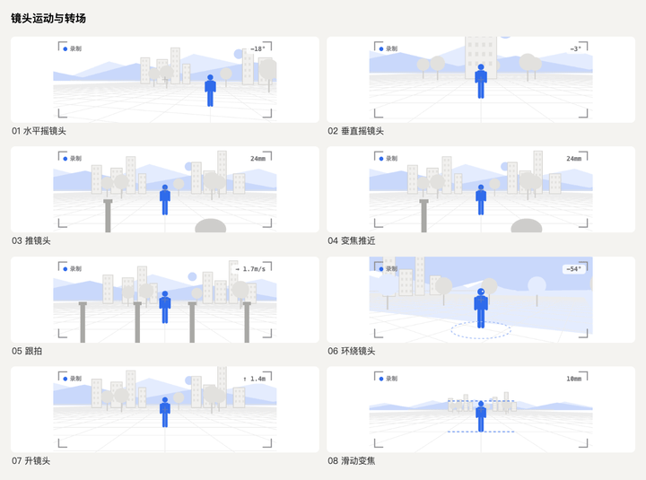
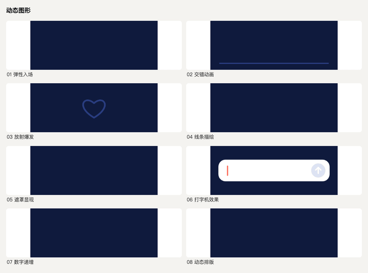

# 制作自己的术语库

[English](README.md) | [日本語](README.ja.md) | **简体中文**

选一个熟悉的领域，用中文提示词和 HTML 模板制作术语视频。每套模板有三页，每页八张动态卡片。每张卡片展示一个术语的含义，可以用同一脚本渲染为循环视频。

| | 镜头运动（`examples/camera-moves/`） | 动态图形（`examples/motion-graphics/`） |
|---|---|---|
| 视觉风格 | 浅灰、单一蓝色、图示风格 | 深海军蓝卡片、四种颜色 |
| 中文模板 | [镜头运动](examples/camera-moves/zh-Hans/index.html) | [动态图形](examples/motion-graphics/zh-Hans/index.html) |
| 原版对照 | [英文](examples/camera-moves/en/index.html) · [日文](examples/camera-moves/ja/index.html) | [日文](examples/motion-graphics/ja/index.html) |
| |  |  |

随原版发布的视频和速查图保留原语言和用词。制作新视频时，可按自己的题材调整配色与布局，让每张卡片始终呈现对应术语的效果。简体中文名称与释义见[术语列表](../packs/README.zh-Hans.md)。

## 目录内容

```text
prompts/en, prompts/ja, prompts/zh-Hans   可复制给编程 AI 或图像 AI 的提示词
render.mjs                              将 HTML 渲染为 MP4（Playwright 和 ffmpeg）
examples/camera-moves/
  zh-Hans/ index.html                    简体中文可渲染模板
  en/  index.html  video-1of3.mp4  video-2of3.mp4  video-3of3.mp4  cheatsheet.png
  ja/  index.html  video-1of3.mp4  video-2of3.mp4  video-3of3.mp4  cheatsheet.png
examples/motion-graphics/
  zh-Hans/ index.html                    简体中文可渲染模板
  ja/  index.html  video-1of3.mp4  video-2of3.mp4  video-3of3.mp4  cheatsheet.png  cheatsheet-prompt.md
```

| 成品 | 规格 |
|---|---|
| 视频 | 1200×1350，30 fps，H.264（yuv420p），无音频，9.4 秒，无缝循环 |
| 速查图 | 根据 `prompts/` 的提示词，由图像生成 AI 制作 |

每个视频来自一个在 `<canvas>` 上绘图的 HTML 文件。无需框架或构建步骤，Claude Code、Codex、Cursor 等编程 AI 可直接读取并修改完整源码。

## 提示词

将仓库提供给编程 AI，再粘贴以下提示词之一。

| 目标 | 提示词 |
|---|---|
| 将视频翻译为其他语言 | [`prompts/zh-Hans/01-translate.md`](prompts/zh-Hans/01-translate.md) |
| 用自己的风格展示熟悉领域的术语 | [`prompts/zh-Hans/02-your-own-field.md`](prompts/zh-Hans/02-your-own-field.md) |
| 制作单页速查图 | [`prompts/zh-Hans/03-cheatsheet-image.md`](prompts/zh-Hans/03-cheatsheet-image.md) |

其他语言的提示词见[制作指南（英文）](README.md)和[制作指南（日文）](README.ja.md)。

手动编辑 `index.html` 时可修改以下常量。

- `PAGES` 和 `ITEMS` 是页面标题与 24 个术语。
- `CELLS[0]` 到 `CELLS[23]` 是每张卡片的绘制函数。
- `C` 控制颜色。字体常量位于文件顶部，例如 `JP`、`EN`、`MONO` 和 `DISP`。

## 预览

用 Chrome 或其他 Chromium 浏览器打开[镜头运动](examples/camera-moves/zh-Hans/index.html)或[动态图形](examples/motion-graphics/zh-Hans/index.html)模板。页面默认循环播放第一页。

- `?page=2` 显示第二页，共三页。
- `?t=3.5` 显示 3.5 秒时的静止画面。

## 渲染为 MP4

需要 [Node.js](https://nodejs.org/) 18 或更高版本，并确保 PATH 中能找到 [ffmpeg](https://ffmpeg.org/)。从仓库根目录运行以下命令。

```bash
cd make-your-own
npm install
npx playwright install chromium

node render.mjs examples/camera-moves/zh-Hans/index.html --all --sheet --out-dir out/camera-zh-Hans
node render.mjs examples/motion-graphics/zh-Hans/index.html --all --sheet --out-dir out/motion-zh-Hans
```

两个输出目录均包含 `zh-Hans-page1.mp4` 至 `zh-Hans-page3.mp4`，以及每页对应的 `-sheet.png`。

支持 `--page <n>`、`--all`、`--pages <n>`、`--out <file>`、`--out-dir <dir>`、`--fps <n>`、`--crf <n>`、`--sheet`。运行 `node render.mjs --help` 查看说明。

`--sheet` 每秒采样一帧，合成一张帧预览图，便于比较每张卡片在不同时间的画面。

### 渲染原理

HTML 不依赖实时钟表，每帧由帧编号决定。

| HTML 中的接口 | 含义 |
|---|---|
| `window.N_FRAMES` | 每页帧数，282 = 9.4 s × 30 fps |
| `window.renderFrame(i)` | 在 `<canvas id="c">` 上绘制第 `i` 帧 |
| `window.prepareFrame(i)` | 可选，可为异步函数 |
| `window.READY` | 字体加载完成后设为 `true` |
| `?page=N`、`?render=1` | 指定页面、关闭预览循环 |

`render.mjs` 逐帧调用 `renderFrame(i)`，读取画布 PNG 并通过管道送入 ffmpeg。即使机器速度较慢，也不会丢帧。遵守这套接口的 HTML 都能使用同一脚本渲染。

## 字体

原附示例不从网络加载字体、CDN 或图片，使用 macOS 自带字体 Helvetica Neue、Avenir Next、Hiragino Sans、SF Mono。这些字体由操作系统提供。

中文版本使用系统中的简体中文字体。Windows 或 Linux 浏览器可能使用不同的后备字体。渲染前检查中文文字是否完整、是否超出版面。更换字体时，修改 `index.html` 顶部的字体常量。日文原版需要日文字体，例如 Noto Sans JP。

## 注意事项

- 日文 HTML 最初是一段依次播放三页、约 30 秒的视频。现有模板按页导出。随日文原版发布的 MP4 保留原帖时间，切换位置可能相差一帧。
- 画布代码使用 `roundRect` 和 `letterSpacing`，需要较新的 Chromium。Playwright 附带的 Chromium 支持这两个接口。
- 两套示例也分别作为 `camera` 和 `motion` 素材包出现在示例库中。添加自己的内容见[贡献指南](../CONTRIBUTING.zh-Hans.md)。

## 许可证

代码、视频和图片按 MIT 许可证发布，允许商业使用。分发代码时保留许可证和版权声明。[MIT 许可证](../LICENSE)
