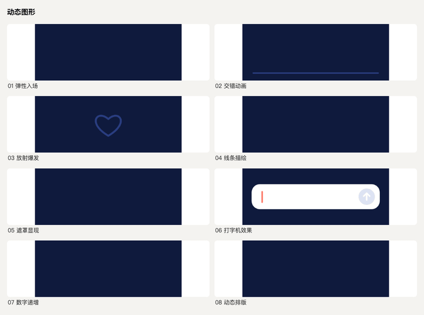

<!-- 由 tools/build.mjs 根据 meta.json 生成。请编辑 meta.json，不要直接修改本文件。 -->

# 动态图形

24 个术语 · #001–024 · 素材包 `motion` · 语言: [English](README.md) / [Español](README.es.md) / [日本語](README.ja.md) / [繁體中文](README.zh-Hant.md)

找到名称后直接告诉 AI。补充时长、幅度和运动对象，可以更接近你想要的效果。

## 入场与文字

| 编号 | 名称 | 英文名 | 含义 | 向 AI 提出需求的示例 |
|---|---|---|---|---|
| [#001](../../index.html?lang=zh-Hans#001) | **弹性入场** | Pop-in | 元素弹跳着出现 | 让标志以弹性入场出现，时长约 0.4 s，略微超出目标尺寸后回弹。 |
| [#002](../../index.html?lang=zh-Hans#002) | **交错动画** | Stagger | 多个元素错开时间依次出现 | 用交错动画让五张卡片从左到右依次入场，每张间隔 0.08 s。 |
| [#003](../../index.html?lang=zh-Hans#003) | **放射爆发** | Burst | 元素出现时向外迸出线条和圆点 | 爱心出现时加一次放射爆发：8 根短线在 0.3 s 内淡出。 |
| [#004](../../index.html?lang=zh-Hans#004) | **线条描绘** | Line draw | 线条像被画出来一样逐渐延伸 | 让图表曲线从左侧开始，在 1.2 s 内逐渐描绘出来。 |
| [#005](../../index.html?lang=zh-Hans#005) | **遮罩显现** | Mask reveal | 文字从不可见的边界后移出 | 让标题从下方通过遮罩显现，时长 0.6 s，各行稍微错开。 |
| [#006](../../index.html?lang=zh-Hans#006) | **打字机效果** | Typewriter | 文字像打字一样逐字出现 | 给这句话添加打字机效果，每个字 0.05 s，末尾保留光标。 |
| [#007](../../index.html?lang=zh-Hans#007) | **数字递增** | Count-up | 数字快速增长到目标值 | 用数字递增让数字在 1.5 s 内从 0 增长到 1,280，末尾减速。 |
| [#008](../../index.html?lang=zh-Hans#008) | **动态排版** | Kinetic typography | 文字随含义和节奏移动、缩放与旋转 | 把旁白做成动态排版，重读词放大，并对齐节拍出现。 |

## 运动细节

| 编号 | 名称 | 英文名 | 含义 | 向 AI 提出需求的示例 |
|---|---|---|---|---|
| [#009](../../index.html?lang=zh-Hans#009) | **缓动** | Easing | 动作通过加减速变化而非匀速移动 | 为这段移动添加缓出，使其逐渐减速停下。 |
| [#010](../../index.html?lang=zh-Hans#010) | **过冲回弹** | Overshoot | 越过目标后回到目标位置并停稳 | 给仪表指针加上过冲回弹：先超出目标约 10%，再回弹到位。 |
| [#011](../../index.html?lang=zh-Hans#011) | **挤压与拉伸** | Squash & stretch | 通过压扁和拉长表现弹性 | 给球落地时加上轻微的挤压与拉伸。 |
| [#012](../../index.html?lang=zh-Hans#012) | **形状变形** | Shape morph | 一种形状平滑变成另一种 | 用形状变形让圆形在 0.8 s 内变成星形，同时由蓝色变成黄色。 |
| [#013](../../index.html?lang=zh-Hans#013) | **液态动效** | Liquid motion | 形状像液体一样流动和融合 | 让标志以液态动效入场，由液滴汇聚成形。 |
| [#014](../../index.html?lang=zh-Hans#014) | **运动拖尾** | Motion trail | 运动物体身后留下逐渐淡去的轨迹 | 给飞行圆球添加五层逐渐淡出的拖尾。 |
| [#015](../../index.html?lang=zh-Hans#015) | **粒子效果** | Particles | 大量小碎片喷出并散开 | 成功时从底部喷出四种颜色的粒子，在 1.5 s 内全部落下。 |
| [#016](../../index.html?lang=zh-Hans#016) | **视差** | Parallax | 远近图层以不同速度移动形成纵深 | 把风景拆成三层，近层滚动更快，形成视差。 |

## 转场与强调

| 编号 | 名称 | 英文名 | 含义 | 向 AI 提出需求的示例 |
|---|---|---|---|---|
| [#017](../../index.html?lang=zh-Hans#017) | **遮罩转场** | Mask transition | 扩大的形状内部显现下一场景 | 用遮罩转场切换场景，让圆从中心在 0.7 s 内扩展开。 |
| [#018](../../index.html?lang=zh-Hans#018) | **图形转场** | Shape transition | 图形覆盖画面后揭示下一场景 | 用四条斜向色带从左侧扫入，完成图形转场。 |
| [#019](../../index.html?lang=zh-Hans#019) | **液态转场** | Liquid transition | 液体流入画面并替换场景 | 用蓝色墨水从顶部滴落铺满画面，完成液态转场。 |
| [#020](../../index.html?lang=zh-Hans#020) | **穿越缩放** | Zoom through | 放大并穿过物体进入下一场景 | 用穿越缩放加速穿过标志中字母 O 的孔洞，进入下一场景，时长 0.6 s。 |
| [#021](../../index.html?lang=zh-Hans#021) | **翻转** | Flip | 像卡片翻面一样展示另一侧 | 让价格卡片在 0.5 s 内翻转，展示背面的详情。 |
| [#022](../../index.html?lang=zh-Hans#022) | **扫光** | Light sweep | 光带扫过物体表面 | 标志停稳后，让一道柔和扫光从左上移到右下。 |
| [#023](../../index.html?lang=zh-Hans#023) | **故障效果** | Glitch | 画面像发生故障一样错位和分色 | 给标题添加 0.3 s 的轻微故障效果，少量分色，不要闪屏。 |
| [#024](../../index.html?lang=zh-Hans#024) | **冲击震动** | Impact shake | 物体落下时带动整个画面震动 | 标题落地时添加冲击震动，在 0.4 s 内停稳。 |

点击编号可打开动态示例。单个术语的时间、缓动数值与参考代码位于： `api/v1/zh-Hans/e/<id>.txt` ([#001](../../api/v1/zh-Hans/e/001.txt)).

[全部素材包](../README.zh-Hans.md)
